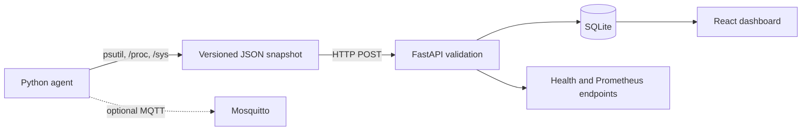

# Embedded Linux Monitoring Platform

A local-first monitoring stack for Linux SBCs. A Python agent reads operating-system metrics, a FastAPI service validates and stores snapshots in SQLite, and a React dashboard displays the stored history. The repository includes container and systemd deployment examples; Raspberry Pi hardware validation is still pending.

## Objective

Provide low-overhead, schema-validated visibility into headless Linux edge devices without requiring a hosted monitoring service. The same telemetry contract supports local collection, HTTP ingestion, durable SQLite history, and a responsive operational dashboard.

## Project Status

### Implemented

- Versioned JSON telemetry collection with `psutil`, optional Linux `/proc` and `/sys` reads, graceful `null` readings, one-shot and continuous CLI modes, HTTP ingestion, and optional MQTT publishing.
- Validated FastAPI endpoints, SQLite persistence, structured logs, health status, bounded history, and Prometheus text metrics.
- Responsive dark EdgeWatch React/TypeScript dashboard with validated API polling every five seconds, CPU/memory history, configurable resource warnings, connection state, and loading, empty, partial-data, error, and recovery states.
- Non-root container images, Nginx API routing, loopback-bound Docker Compose services, optional Mosquitto profile, systemd unit example, and GitHub Actions workflow.

### Five-step completion status

| Step | Status | Verification boundary |
| --- | --- | --- |
| 1. Embedded Linux telemetry agent | Implemented | Unit-tested on this Mac; Linux `/proc`, `/sys`, and SBC sensors remain hardware-unverified. |
| 2. FastAPI and SQLite backend | Implemented | 22-test suite covers API, persistence, restart, validation, and integration paths. |
| 3. React/TypeScript dashboard | Implemented | 6 UI tests, production build, and live browser/API check passed. |
| 4. Containers, MQTT, systemd, CI | Implemented | Compose/profile parsing and GitHub image-build CI passed; local containers, broker delivery, and Linux systemd remain unverified. |
| 5. Integration, tests, documentation | Implemented | Agent-to-API-to-SQLite integration and documented status/limitations are covered; physical-board verification is pending. |

### Locally verified in this workspace

- Python agent, API validation, SQLite persistence, database-failure handling, and collector-to-API integration tests.
- Frontend component tests, strict TypeScript check, and production Vite build.
- Ruff checks and Docker Compose configuration parsing.
- The one-shot agent emitted JSON that parsed successfully on this Intel Mac.
- Verification date: 2026-10-13. The Python suite passed all 22 tests and Ruff passed; the frontend suite passed all 6 tests and its production build completed.
- A live API smoke test returned `200` for health/docs, `404` for an empty latest sample, ingested and retrieved one real Mac agent sample, returned chronological history, emitted Prometheus process metrics, and rejected `limit=501` with `422`.
- An isolated end-to-end run posted a real agent sample to FastAPI, read it from latest/history, rejected invalid CPU input with `422`, and confirmed the sample survived stopping and restarting Uvicorn against the same temporary SQLite file. The live EdgeWatch page also loaded that isolated API sample.

These checks verify the current Mac/software path only. Both default and MQTT-profile Compose configurations parse locally. `docker compose build` could not run on this Mac because the Docker daemon was unavailable; local container startup and volume-persistence behavior therefore remain unverified. The GitHub Ubuntu deployment job did build both images. MQTT publishing is unit-tested, but broker delivery was not verified because Docker and Mosquitto client tools were unavailable. No screenshot files, performance benchmarks, or physical-device measurements are included.

### CI-verified

The workflow at [`.github/workflows/ci.yml`](.github/workflows/ci.yml) runs Python lint/tests, frontend tests/build, both Compose profile checks, and backend/frontend image builds on pushes and pull requests to `main`. GitHub Actions completed successfully for commit `ff8a54b`; the `python`, `frontend`, and `deployment` jobs all passed, including both container image builds on Ubuntu. A documentation-only follow-up CI run for `c55c484` also passed.

### Optional features

- MQTT publishing is disabled unless `MQTT_BROKER` or `--mqtt-broker` is supplied. The Compose Mosquitto broker is available with the `mqtt` profile and is intentionally anonymous for local development only.
- Linux CPU temperature is read when an accessible thermal-zone sensor exists; otherwise the value is `null`.

### Physical hardware validation pending

No Raspberry Pi or other SBC tests have been performed. Follow [the hardware validation checklist](docs/troubleshooting.md#linux-sbc-validation) before describing hardware support as physically verified. No screenshots or benchmarks are claimed.

## Architecture



See [architecture and data flow](docs/architecture.md) for component boundaries and the message path.

## Technology Stack

| Technology | Purpose | Implementation |
| --- | --- | --- |
| Python 3.11+, psutil | Host sampling and CLI transports | [`agent/telemetry_agent.py`](agent/telemetry_agent.py) |
| Linux `/proc`, `/sys` | Load, uptime, and optional thermal reading | [`agent/telemetry_agent.py`](agent/telemetry_agent.py) |
| FastAPI, Pydantic, Uvicorn | Validated HTTP API and OpenAPI | [`backend/app/main.py`](backend/app/main.py), [`backend/app/routes.py`](backend/app/routes.py), [`backend/app/schemas.py`](backend/app/schemas.py) |
| SQLite | Durable telemetry snapshots and bounded queries | [`backend/app/database.py`](backend/app/database.py), configured by [`backend/app/config.py`](backend/app/config.py) |
| React, TypeScript, Vite | Browser application and production build | [`frontend/src/`](frontend/src/), [`frontend/vite.config.ts`](frontend/vite.config.ts) |
| Recharts | CPU and memory time-series visualization | [`frontend/src/App.tsx`](frontend/src/App.tsx) |
| Paho MQTT, Eclipse Mosquitto | Optional JSON telemetry publisher and local broker; no SQLite bridge | [`agent/telemetry_agent.py`](agent/telemetry_agent.py), [`deploy/mosquitto/mosquitto.conf`](deploy/mosquitto/mosquitto.conf) |
| Docker, Docker Compose, Nginx | Local container deployment, shared network, proxy, persistent SQLite volume | [`docker-compose.yml`](docker-compose.yml), [`backend/Dockerfile`](backend/Dockerfile), [`frontend/Dockerfile`](frontend/Dockerfile), [`deploy/nginx.conf`](deploy/nginx.conf) |
| systemd | Hardened Linux agent service example | [`deploy/systemd/edge-monitor.service`](deploy/systemd/edge-monitor.service) |
| pytest, FastAPI TestClient (HTTPX2 transport), Vitest, Testing Library | Backend and UI tests | [`backend/tests/`](backend/tests/), [`frontend/src/App.test.tsx`](frontend/src/App.test.tsx) |
| Ruff, GitHub Actions | Python lint and automated CI checks | [`pyproject.toml`](pyproject.toml), [`.github/workflows/ci.yml`](.github/workflows/ci.yml) |

## Repository Layout

```text
agent/                   Python collector, CLI, and tests
backend/app/             FastAPI app, configuration, routes, schema, SQLite persistence
backend/tests/           API, persistence, and end-to-end integration tests
frontend/src/            React dashboard, API client, styles, and UI tests
deploy/                  Nginx, Mosquitto, and systemd configuration
deploy/mosquitto/        Optional broker config
deploy/systemd/          Linux telemetry agent service
docs/                    Architecture and troubleshooting guides
.github/workflows/       CI workflow
docker-compose.yml       Local API, dashboard, and optional MQTT broker
requirements*.txt        Python runtime and development dependencies
frontend/package.json    Frontend dependencies and scripts
Makefile                 Common local commands
```

## Requirements

- macOS Intel or Apple Silicon for local development; Python 3.11+, Node.js 22+, and npm.
- Docker Desktop with Docker Compose v2 for container deployment.
- Linux for `/proc` and `/sys` readings and the systemd service. The agent remains runnable on macOS using supported `psutil`/platform metrics.

## Install and Run Locally

From the repository root, create a Python virtual environment and install the declared Python dependencies:

```sh
python3.11 -m venv .venv
.venv/bin/python -m pip install -r requirements.txt
```

Install the frontend dependencies:

```sh
cd frontend
npm ci
cd ..
```

Start the API, agent, and dashboard in three terminals. Vite proxies API requests to the local backend by default.

```sh
# Terminal 1: API and OpenAPI at http://127.0.0.1:8000/docs
.venv/bin/uvicorn backend.app.main:app --reload --host 127.0.0.1
```

```sh
# Terminal 2: sample every 15 seconds and ingest into the local API
.venv/bin/python -m agent.telemetry_agent --interval 15 --backend-url http://127.0.0.1:8000
```

```sh
# Terminal 3
cd frontend
npm run dev -- --host 127.0.0.1
```

Open `http://127.0.0.1:5173`. The backend creates `data/telemetry.db` on first use. For a one-shot JSON sample, run `.venv/bin/python -m agent.telemetry_agent`.

To configure a direct cross-origin browser API URL instead of Vite's proxy, set both `VITE_API_BASE_URL=http://127.0.0.1:8000` and `CORS_ALLOWED_ORIGINS=http://127.0.0.1:5173` before starting the frontend and backend. CORS is disabled by default.

### EdgeWatch dashboard

The frontend requires Node.js 22+ and npm. Install the lockfile dependencies with `cd frontend && npm ci`. Start development mode with `npm run dev -- --host 127.0.0.1`; the dashboard is served at `http://127.0.0.1:5173`.

`VITE_API_BASE_URL` is optional and defaults to the same origin: Vite proxies `/health` and `/api` to `http://127.0.0.1:8000` locally, while the production Nginx service proxies the same paths to the backend. This avoids relying on `localhost` from inside containers. For a direct API origin, set this variable and allow the exact dashboard origin using `CORS_ALLOWED_ORIGINS`. These are public build-time settings; never place secrets in frontend environment variables.

Polling calls health, latest, and the last 60 history samples every five seconds. Warning defaults are CPU 85%, memory 85%, and disk 90%; configure them with `VITE_CPU_WARNING_THRESHOLD`, `VITE_MEMORY_WARNING_THRESHOLD`, and `VITE_DISK_WARNING_THRESHOLD` (valid range 1–100). Alerts are advisory thresholds, not hardware fault diagnosis. Run `npm test` for UI tests and `npm run build` for the strict TypeScript check and production bundle.

## Docker Compose

The backend and Nginx frontend communicate over the named `monitoring` bridge network. Nginx serves the built Vite assets and proxies `/api`, `/health`, and `/metrics` to the `backend` service; container requests do not use host `localhost`. Both host ports bind to `127.0.0.1` by default. `backend/Dockerfile` installs runtime-only Python dependencies, runs Uvicorn as an unprivileged user, and persists SQLite at `/data/telemetry.db`. `frontend/Dockerfile` builds with Node 22 and serves static assets from unprivileged Nginx on port 8080.

```sh
cp .env.example .env
docker compose config
# Run in the foreground; use another terminal for ps/logs.
docker compose up --build
# Or use detached mode:
docker compose up --build -d
docker compose ps
docker compose logs --tail=100
docker compose down
```

The backend, frontend, and optional broker share the isolated `monitoring` bridge network. Nginx uses the Compose service name `backend`; containers do not use host `localhost` to reach each other. Host ports bind to `127.0.0.1` by default. The dashboard is at `http://127.0.0.1:8080`; the API is at `http://127.0.0.1:8000`. Backend and frontend health checks gate service readiness. The `telemetry-data` named volume survives `docker compose down`; `docker compose down -v` removes the volumes and permanently deletes stored telemetry (and MQTT persistence data).

### Optional MQTT

Mosquitto is opt-in and binds to loopback on port 1883. The sample broker config permits anonymous clients for local development only; do not expose it to an untrusted network. No broker subscriber or MQTT-to-SQLite persistence bridge is implemented. Normal HTTP ingestion is independent of MQTT.

Start the broker and wait for its health check:

```sh
docker compose --profile mqtt up --build -d
docker compose ps
docker compose logs --tail=100 mosquitto
```

In one terminal, subscribe from inside the broker container:

```sh
docker compose exec mosquitto mosquitto_sub -h 127.0.0.1 -t edge/telemetry -v
```

In another terminal, publish a real host sample from the Mac/Linux host agent:

```sh
MQTT_BROKER=127.0.0.1 .venv/bin/python -m agent.telemetry_agent \
  --interval 15 --mqtt-broker 127.0.0.1 --mqtt-port 1883 \
  --mqtt-topic edge/telemetry --mqtt-timeout 5
```

The agent publishes the same schema-version `1.0` JSON snapshot used for HTTP ingestion with QoS 1 and a bounded five-second connect/publish timeout. Failures are logged and do not terminate sampling. Broker authentication and TLS are not configured in this local profile; configure both and restrict network access before production use. MQTT message delivery was not runtime-verified in this workspace because the Docker daemon and Mosquitto client tools were unavailable.

### Linux systemd agent

The example unit is `deploy/systemd/edge-monitor.service`. It assumes the repository is installed at `/opt/edgewatch`, the `edge-monitor` system/group exist, and an API is reachable. On a Linux target, create the service account and install the application/runtime environment, then install the unit:

```sh
sudo useradd --system --user-group --create-home --home-dir /var/lib/edge-monitor --shell /usr/sbin/nologin edge-monitor
sudo git clone https://github.com/PrajwalMhetre/Embedded-Linux-Monitoring-Platform.git /opt/edgewatch
sudo chown -R edge-monitor:edge-monitor /opt/edgewatch
sudo -u edge-monitor python3.11 -m venv /opt/edgewatch/.venv
sudo -u edge-monitor /opt/edgewatch/.venv/bin/pip install -r /opt/edgewatch/requirements-runtime.txt
sudo install -d -o root -g edge-monitor -m 0750 /etc/edge-monitor
sudo install -o root -g edge-monitor -m 0640 /dev/null /etc/edge-monitor/agent.env
sudoedit /etc/edge-monitor/agent.env
sudo install -m 0644 deploy/systemd/edge-monitor.service /etc/systemd/system/edge-monitor.service
sudo systemctl daemon-reload
sudo systemctl enable --now edge-monitor
sudo systemctl status edge-monitor
sudo journalctl -u edge-monitor -f
```

Set `AGENT_API_URL` and `AGENT_INTERVAL` in the protected environment file. Optional MQTT settings are `MQTT_BROKER`, `MQTT_PORT`, `MQTT_TOPIC`, and `MQTT_TIMEOUT_SECONDS`; keep credentials in a root-owned mode-0640 environment file and never commit it. Remove the service with `sudo systemctl disable --now edge-monitor`, `sudo rm /etc/systemd/system/edge-monitor.service`, then `sudo systemctl daemon-reload`. This example has not been installed or tested on a Linux host.

### CI deployment checks

`.github/workflows/ci.yml` runs Python tests/Ruff and frontend tests/build, then validates both Compose profiles and builds the backend/frontend images on GitHub-hosted Ubuntu. A CI workflow result is reported only after the corresponding Actions run completes.

## API

Interactive OpenAPI documentation is served at `/docs`; the schema is at `/openapi.json`.

| Method | Path | Success | Behavior |
| --- | --- | --- | --- |
| `GET` | `/health` | `200` | `{"status":"ok","database":"ok"}`; `503` with `{"status":"unhealthy","database":"unavailable"}` when DB is unavailable |
| `GET` | `/metrics` | `200` | HELP/TYPE-described sample, host resource, process RSS/CPU/thread metrics; `503` when DB is unavailable |
| `POST` | `/api/v1/metrics` | `201` | Validate and persist one snapshot; `422` invalid input, `503` storage failure |
| `GET` | `/api/v1/metrics/latest` | `200` | Latest stored snapshot; `404` when empty, `503` on DB failure |
| `GET` | `/api/v1/metrics/history?limit=60` | `200` | Latest bounded window, ordered oldest-to-newest; limit range 1–500, `422` outside range, `503` on DB failure |

Example ingestion request:

```sh
curl -i http://127.0.0.1:8000/api/v1/metrics \
  -H 'Content-Type: application/json' \
  -d '{
    "schema_version":"1.0",
    "timestamp":"2026-10-13T12:00:00Z",
    "hostname":"edge-board",
    "os":{"system":"Linux","release":"6.1","version":"example","machine":"aarch64"},
    "cpu_percent":12.5,
    "memory_percent":40.0,
    "disk_root_percent":60.0,
    "load_average":[0.1,0.2,0.3],
    "uptime_seconds":1200,
    "process_count":42,
    "cpu_temperature_c":null
  }'
```

The successful response is `201 Created` with the validated telemetry JSON, normalized to UTC. For the example above, its body is:

```json
{
  "schema_version": "1.0",
  "timestamp": "2026-10-13T12:00:00Z",
  "hostname": "edge-board",
  "os": {"system": "Linux", "release": "6.1", "version": "example", "machine": "aarch64"},
  "cpu_percent": 12.5,
  "memory_percent": 40.0,
  "disk_root_percent": 60.0,
  "load_average": [0.1, 0.2, 0.3],
  "uptime_seconds": 1200.0,
  "process_count": 42,
  "cpu_temperature_c": null
}
```

Metric readings that are unsupported may be `null`. Percentages must be between 0 and 100; timestamps must include a timezone; extra fields and non-finite values are rejected. History returns the newest requested records ordered oldest-to-newest within that window.

`/metrics` exposes HELP/TYPE-described Prometheus samples for stored sample counts, latest reported host CPU/memory/disk percentages, and API process RSS, CPU seconds, and thread count. A metric is omitted when its source reading is unavailable. `/api/v1/metrics/history` first selects the newest requested samples, then returns them in chronological order. Routes live in `backend/app/routes.py`, environment settings in `backend/app/config.py`, validation in `backend/app/schemas.py`, and SQLite operations in `backend/app/database.py`.

## Configuration

Copy `.env.example` to `.env` for Compose overrides. `HOST_BIND_ADDRESS` defaults to `127.0.0.1`, `LOG_LEVEL` defaults to `INFO`, and `CORS_ALLOWED_ORIGINS` is empty unless a direct browser origin is needed. The local API's `DATABASE_PATH` defaults to `data/telemetry.db`; Compose sets it to `/data/telemetry.db` on its persistent volume. `VITE_API_BASE_URL` defaults to empty, which uses the Vite development proxy or Nginx same-origin routing. Dashboard warning thresholds are build-time Vite variables: `VITE_CPU_WARNING_THRESHOLD`, `VITE_MEMORY_WARNING_THRESHOLD`, and `VITE_DISK_WARNING_THRESHOLD` (1–100; defaults 85, 85, and 90). Rebuild the frontend image after changing them.

The agent accepts `--interval`, `--backend-url`, `--mqtt-broker`, `--mqtt-port`, `--mqtt-topic`, and `--mqtt-timeout`. MQTT options can also be set with `MQTT_BROKER`, `MQTT_PORT`, `MQTT_TOPIC`, and `MQTT_TIMEOUT_SECONDS`; no broker is contacted unless configured. The default topic is `edge/telemetry` and the default publish timeout is five seconds.

## Checks

```sh
.venv/bin/python -m pytest
.venv/bin/ruff check agent backend
cd frontend && npm test && npm run build
```

Or use `make test`, `make lint`, and `make build` after installing both dependency sets. Compose checks: `docker compose config` and `docker compose --profile mqtt config`. GitHub Actions also builds both images; a configured workflow is not itself evidence of a successful remote run.

## Security Notes

- Compose publishes unauthenticated development endpoints on loopback only. Keep `HOST_BIND_ADDRESS` at `127.0.0.1` unless you add an authenticated, TLS-terminating boundary.
- The API has no authentication, authorization, TLS, rate limiting, or tenant separation. Do not publish it directly to the internet.
- Mosquitto's example allows anonymous connections and is only appropriate for an isolated local development setup. Add credentials/TLS and restrictive network policy before any shared deployment.
- The backend uses parameterized SQL and Pydantic validation. It stores host identifiers and metrics locally; protect the SQLite volume and backups.
- The systemd example runs as a dedicated unprivileged user and applies basic systemd hardening.

## Limitations

- No physical Linux SBC validation, screenshots, performance benchmarks, or remote deployment are claimed.
- Linux-only `/proc` and `/sys` behavior varies by kernel and permissions; missing readings are represented as `null`.
- SQLite history has no retention/rotation policy and is intended for a small local deployment, not a multi-node high-write service.
- The dashboard shows the latest global history, with no device selector or multi-device fleet view.
- MQTT publishing is optional and has no TLS/authentication settings in the example agent workflow.

## Linux SBC Validation

Hardware checks have not yet been performed. On a Raspberry Pi or another Linux SBC:

1. Record board model, distro, kernel, Python version, and service user.
2. Install the repository's runtime requirements and run `python -m agent.telemetry_agent`; parse the single output line as JSON.
3. Compare load/uptime readings with `/proc/loadavg` and `/proc/uptime`; inspect thermal-zone files if present.
4. Start a trusted API endpoint, run the agent with `--backend-url`, and verify ingestion, latest/history, and the dashboard.
5. Repeat under the intended unprivileged systemd user, checking that inaccessible optional readings are null and the service remains active.
6. Record actual results before claiming hardware validation.

More detailed setup and troubleshooting: [`docs/troubleshooting.md`](docs/troubleshooting.md).
