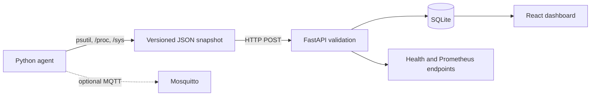

# Embedded Linux Monitoring Platform

A local-first monitoring stack for Linux SBCs. A Python agent reads operating-system metrics, a FastAPI service validates and stores snapshots in SQLite, and a React dashboard displays the stored history. The repository includes container and systemd deployment examples; Raspberry Pi hardware validation is still pending.

## Project Status

### Implemented

- Versioned JSON telemetry collection with `psutil`, optional Linux `/proc` and `/sys` reads, graceful `null` readings, one-shot and continuous CLI modes, HTTP ingestion, and optional MQTT publishing.
- Validated FastAPI endpoints, SQLite persistence, structured logs, health status, bounded history, and Prometheus text metrics.
- Responsive React/TypeScript dashboard with real API polling, CPU/memory history, resource warnings, connection state, and loading, empty, and error states.
- Non-root container images, Nginx API routing, loopback-bound Docker Compose services, optional Mosquitto profile, systemd unit example, and GitHub Actions workflow.

### Locally verified in this workspace

- Python agent, API validation, SQLite persistence, database-failure handling, and collector-to-API integration tests.
- Frontend component tests, strict TypeScript check, and production Vite build.
- Ruff checks and Docker Compose configuration parsing.
- The one-shot agent emitted JSON that parsed successfully on this Intel Mac.

These checks verify the current Mac/software path only. Docker Compose syntax was checked, but image builds and container startup could not be verified because the Docker daemon was not running in this workspace. No remote deployment is claimed.

### CI-verified

The workflow at [`.github/workflows/ci.yml`](.github/workflows/ci.yml) runs Python lint/tests and frontend tests/build for pushes and pull requests. GitHub Actions succeeded for commit `99d9ffc` with both the `python` and `frontend` jobs passing. Check the Actions tab for the status of newer commits.

### Optional features

- MQTT publishing is disabled unless `MQTT_BROKER` or `--mqtt-broker` is supplied. The Compose Mosquitto broker is available with the `mqtt` profile and is intentionally anonymous for local development only.
- Linux CPU temperature is read when an accessible thermal-zone sensor exists; otherwise the value is `null`.

### Physical hardware validation pending

No Raspberry Pi or other SBC tests have been performed. Follow [the hardware validation checklist](docs/troubleshooting.md#linux-sbc-validation) before describing hardware support as physically verified. No screenshots or benchmarks are claimed.

## Architecture



See [architecture and data flow](docs/architecture.md) for component boundaries and the message path.

## Technology Stack

| Technology | Purpose | Implementation |
| --- | --- | --- |
| Python 3.11+, psutil | Host sampling and CLI transports | [`agent/telemetry_agent.py`](agent/telemetry_agent.py) |
| Linux `/proc`, `/sys` | Load, uptime, and optional thermal reading | [`agent/telemetry_agent.py`](agent/telemetry_agent.py) |
| FastAPI, Pydantic, Uvicorn | Validated HTTP API and OpenAPI | [`backend/app/main.py`](backend/app/main.py), [`backend/app/schemas.py`](backend/app/schemas.py) |
| SQLite | Durable telemetry snapshots and bounded queries | [`backend/app/database.py`](backend/app/database.py) |
| React, TypeScript, Vite | Browser application and production build | [`frontend/src/`](frontend/src/), [`frontend/vite.config.ts`](frontend/vite.config.ts) |
| Recharts | CPU and memory time-series visualization | [`frontend/src/App.tsx`](frontend/src/App.tsx) |
| Paho MQTT, Eclipse Mosquitto | Optional local MQTT publisher and broker | [`agent/telemetry_agent.py`](agent/telemetry_agent.py), [`deploy/mosquitto.conf`](deploy/mosquitto.conf) |
| Docker, Docker Compose, Nginx | Local container deployment and API proxy | [`docker-compose.yml`](docker-compose.yml), [`deploy/nginx.conf`](deploy/nginx.conf) |
| systemd | Linux agent service example | [`deploy/telemetry-agent.service`](deploy/telemetry-agent.service) |
| pytest, FastAPI TestClient (HTTPX2 transport), Vitest, Testing Library | Backend and UI tests | [`backend/tests/`](backend/tests/), [`frontend/src/App.test.tsx`](frontend/src/App.test.tsx) |
| Ruff, GitHub Actions | Python lint and automated CI checks | [`pyproject.toml`](pyproject.toml), [`.github/workflows/ci.yml`](.github/workflows/ci.yml) |

## Repository Layout

```text
agent/                   Python collector, CLI, and tests
backend/app/             FastAPI routes, Pydantic schema, SQLite persistence
backend/tests/           API, persistence, and end-to-end integration tests
frontend/src/            React dashboard, API client, styles, and UI tests
deploy/                  Nginx, Mosquitto, and systemd configuration
docs/                    Architecture and troubleshooting guides
.github/workflows/       CI workflow
docker-compose.yml       Local API, dashboard, and optional MQTT broker
requirements*.txt        Python runtime and development dependencies
frontend/package.json    Frontend dependencies and scripts
Makefile                 Common local commands
```

## Requirements

- macOS Intel or Apple Silicon for local development; Python 3.11+, Node.js 22+, and npm.
- Docker Desktop with Docker Compose v2 for container deployment.
- Linux for `/proc` and `/sys` readings and the systemd service. The agent remains runnable on macOS using supported `psutil`/platform metrics.

## Install and Run Locally

From the repository root, create a Python virtual environment and install the declared Python dependencies:

```sh
python3.11 -m venv .venv
.venv/bin/python -m pip install -r requirements.txt
```

Install the frontend dependencies:

```sh
cd frontend
npm ci
cd ..
```

Start the API, agent, and dashboard in three terminals. Vite proxies API requests to the local backend by default.

```sh
# Terminal 1: API and OpenAPI at http://127.0.0.1:8000/docs
.venv/bin/uvicorn backend.app.main:app --reload --host 127.0.0.1
```

```sh
# Terminal 2: sample every 15 seconds and ingest into the local API
.venv/bin/python -m agent.telemetry_agent --interval 15 --backend-url http://127.0.0.1:8000
```

```sh
# Terminal 3
cd frontend
npm run dev -- --host 127.0.0.1
```

Open `http://127.0.0.1:5173`. The backend creates `data/telemetry.db` on first use. For a one-shot JSON sample, run `.venv/bin/python -m agent.telemetry_agent`.

To configure a direct cross-origin browser API URL instead of Vite's proxy, set both `VITE_API_BASE_URL=http://127.0.0.1:8000` and `CORS_ALLOWED_ORIGINS=http://127.0.0.1:5173` before starting the frontend and backend. CORS is disabled by default.

## Docker Compose

```sh
cp .env.example .env
docker compose up --build
```

The dashboard is at `http://127.0.0.1:8080`; the API is at `http://127.0.0.1:8000`. Published ports bind to loopback by default. To enable the optional local MQTT broker, run `docker compose --profile mqtt up --build`; the broker binds to `127.0.0.1:1883` and permits anonymous connections, so do not expose it on an untrusted network.

Stop services with `docker compose down`. Persistent telemetry and MQTT data remain in named volumes; `docker compose down -v` deletes those volumes and their data.

## API

Interactive OpenAPI documentation is served at `/docs`; the schema is at `/openapi.json`.

| Method | Path | Success | Behavior |
| --- | --- | --- | --- |
| `GET` | `/health` | `200` | Database readiness; `503` if unavailable |
| `GET` | `/metrics` | `200` | Prometheus text exposition |
| `POST` | `/api/v1/metrics` | `201` | Validate and persist one snapshot; `422` invalid input, `503` storage failure |
| `GET` | `/api/v1/metrics/latest` | `200` | Latest stored snapshot; `404` when empty |
| `GET` | `/api/v1/metrics/history?limit=60` | `200` | Newest-first snapshots; limit range 1–1000 |

Example ingestion request:

```sh
curl -i http://127.0.0.1:8000/api/v1/metrics \
  -H 'Content-Type: application/json' \
  -d '{
    "schema_version":"1.0",
    "timestamp":"2026-10-13T12:00:00Z",
    "hostname":"edge-board",
    "os":{"system":"Linux","release":"6.1","version":"example","machine":"aarch64"},
    "cpu_percent":12.5,
    "memory_percent":40.0,
    "disk_root_percent":60.0,
    "load_average":[0.1,0.2,0.3],
    "uptime_seconds":1200,
    "process_count":42,
    "cpu_temperature_c":null
  }'
```

Metric readings that are unsupported may be `null`. Percentages must be between 0 and 100; timestamps must include a timezone; extra fields and non-finite values are rejected.

## Configuration

Copy `.env.example` to `.env` for Compose overrides. `HOST_BIND_ADDRESS` defaults to `127.0.0.1`, `LOG_LEVEL` defaults to `INFO`, and `CORS_ALLOWED_ORIGINS` is empty unless a direct browser origin is needed. `VITE_API_BASE_URL` defaults to empty, which uses the Vite development proxy or Nginx same-origin routing. Dashboard warning thresholds are build-time Vite variables: `VITE_CPU_WARNING_THRESHOLD`, `VITE_MEMORY_WARNING_THRESHOLD`, and `VITE_DISK_WARNING_THRESHOLD` (1–100; defaults 85, 85, and 90). Rebuild the frontend image after changing them.

The agent accepts `--interval`, `--backend-url`, `--mqtt-broker`, `--mqtt-port`, and `--mqtt-topic`. MQTT options can also be set with `MQTT_BROKER`, `MQTT_PORT`, and `MQTT_TOPIC`; no broker is contacted unless configured. The default topic is `embedded-monitoring/telemetry`.

## Checks

```sh
.venv/bin/python -m pytest
.venv/bin/ruff check agent backend
cd frontend && npm test && npm run build
```

Or use `make test`, `make lint`, and `make build` after installing both dependency sets. Compose syntax can be checked with `docker compose config -q`. GitHub Actions runs the Python and frontend checks on pushes and pull requests; a configured workflow is not itself evidence of a successful remote run.

## Security Notes

- Compose publishes unauthenticated development endpoints on loopback only. Keep `HOST_BIND_ADDRESS` at `127.0.0.1` unless you add an authenticated, TLS-terminating boundary.
- The API has no authentication, authorization, TLS, rate limiting, or tenant separation. Do not publish it directly to the internet.
- Mosquitto's example allows anonymous connections and is only appropriate for an isolated local development setup. Add credentials/TLS and restrictive network policy before any shared deployment.
- The backend uses parameterized SQL and Pydantic validation. It stores host identifiers and metrics locally; protect the SQLite volume and backups.
- The systemd example runs as a dedicated unprivileged user and applies basic systemd hardening.

## Limitations

- No physical Linux SBC validation, screenshots, performance benchmarks, or remote deployment are claimed.
- Linux-only `/proc` and `/sys` behavior varies by kernel and permissions; missing readings are represented as `null`.
- SQLite history has no retention/rotation policy and is intended for a small local deployment, not a multi-node high-write service.
- The dashboard shows the latest global history, with no device selector or multi-device fleet view.
- MQTT publishing is optional and has no TLS/authentication settings in the example agent workflow.

## Linux SBC Validation

Hardware checks have not yet been performed. On a Raspberry Pi or another Linux SBC:

1. Record board model, distro, kernel, Python version, and service user.
2. Install the repository's runtime requirements and run `python -m agent.telemetry_agent`; parse the single output line as JSON.
3. Compare load/uptime readings with `/proc/loadavg` and `/proc/uptime`; inspect thermal-zone files if present.
4. Start a trusted API endpoint, run the agent with `--backend-url`, and verify ingestion, latest/history, and the dashboard.
5. Repeat under the intended unprivileged systemd user, checking that inaccessible optional readings are null and the service remains active.
6. Record actual results before claiming hardware validation.

More detailed setup and troubleshooting: [`docs/troubleshooting.md`](docs/troubleshooting.md).
