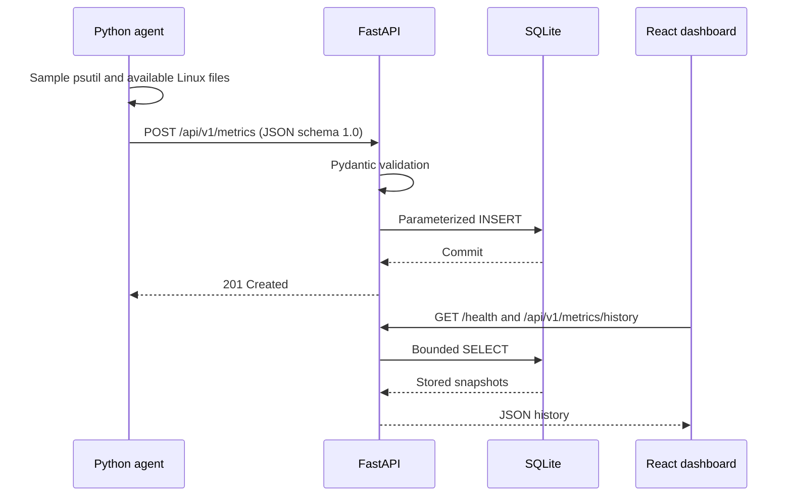

# Architecture and Data Flow

## Components

- `agent/telemetry_agent.py` collects host metrics, validates the emitted field ranges, and serializes schema version `1.0`. `psutil` provides cross-platform CPU, memory, filesystem, process, and boot-time metrics. Linux `/proc` supplies load and uptime where present; `/sys` thermal zones are optional. HTTP uses the Python standard library; MQTT uses Paho when requested.
- `backend/app/schemas.py` is the API contract. It rejects unknown fields, invalid ranges, non-finite numbers, and timestamps without a timezone.
- `backend/app/config.py` resolves the database path, logging level, and optional CORS origins from environment configuration.
- `backend/app/routes.py` exposes health, telemetry ingestion/retrieval, and HELP/TYPE-described Prometheus exposition. Its process metrics use psutil RSS, CPU time, and thread count; telemetry metrics report the latest host CPU/memory/disk values.
- `backend/app/database.py` owns SQLite initialization and parameterized reads/writes. Each operation uses a short-lived connection. History selects at most 500 newest samples and returns that window in chronological order.
- `backend/app/main.py` creates the FastAPI application, configures logging/CORS, initializes the database, and registers the routes.
- `frontend/src/api.ts` reads backend health and chronological history. `frontend/src/App.tsx` renders the last sample as current and charts the returned timeline without generating substitute metric data.
- `deploy/nginx.conf` serves the production frontend and proxies API/health/metrics paths to the backend container.

## Telemetry Path

MQTT is a separate optional publisher path from the agent. The current backend ingests telemetry over HTTP; no MQTT subscription or broker-to-database bridge is implemented.

## Local Network Boundaries

Compose places the frontend, backend, and optional Mosquitto service on its private project network. Host ports are published to `127.0.0.1` by default. Nginx makes browser requests to the backend through same-origin paths; CORS remains disabled unless an explicit origin is configured for a direct development API URL.